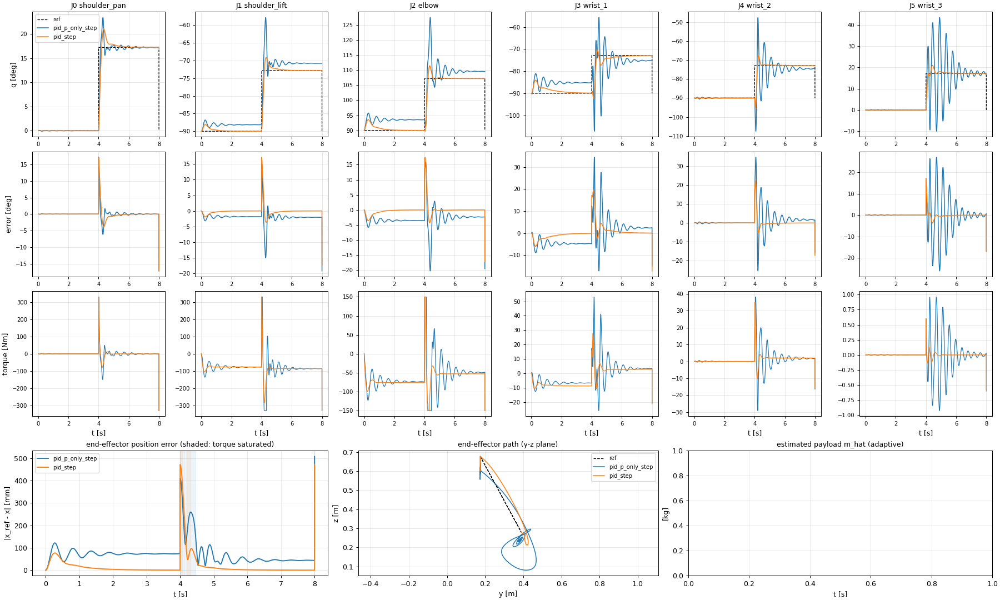
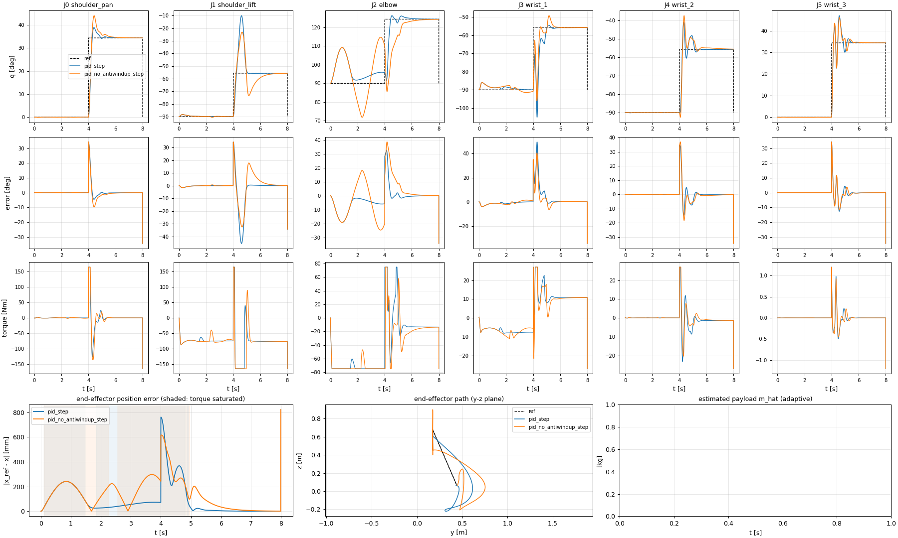

# 1. PID 制御 — モデルを使わない基本の制御

> **準備**: [起動・操作マニュアル](START_HERE.md) の 3〜4 章の手順で、**端末 1** でシミュレーションを起動し（`ros2 launch ur10e_control_lab lab.launch.py`）、
> **端末 2** で `cd ~/sandbox_for_claude/ur10e_control_lab_ws && source install/setup.bash` を済ませておきます。
> 特に断りがなければ、この章のコマンドは端末 2 で実行します。`offline_sim` と `plot_log` は Gazebo を起動していなくても実行できます。
> 終わったら端末 1 で `Ctrl+C`。動きがおかしくなったら `ros2 param set /control_lab reference hold` → `ros2 param set /control_lab controller pd_gravity` で初期姿勢の保持に戻せます。

## 1.1 この章で学ぶこと

- P・I・D それぞれの役割
- 重力が「定常外乱」として働き、P 制御だけでは**定常偏差**が残ること
- I 項による定常偏差の除去と、その副作用である**ワインドアップ**
- 関節を独立に扱うことの限界（関節間の干渉）

## 1.2 理論

各関節を独立した 1 入力 1 出力系とみなし、関節ごとに

```
e(t) = q_ref(t) − q(t)
τ(t) = Kp·e(t) + Ki·∫e(t)dt + Kd·(q̇_ref − q̇)
```

とします。ロボットのモデル（M, C, g）は一切使いません。

**重力と定常偏差**: 静止状態（q̇ = q̈ = 0）では運動方程式は `g(q) = τ` です。
P 制御だけだと `τ = Kp·e` なので、釣り合うには **e = g(q)/Kp ≠ 0** が必要です。
つまり重力を支えるために、必ず目標から少し垂れ下がります。Kp を大きくすれば偏差は小さくなりますが、0 にはなりません。

**I 項**: 誤差が残っている限り積分が増え続けるので、最終的に `Ki·∫e = g(q)` となって e → 0 になります。

**ワインドアップ**: トルクが上限で飽和している間も誤差は積分され続けます。目標に着いた時点で積分が溜まりすぎていると、
それが抜けるまで大きく行き過ぎます。対策（アンチワインドアップ）として、この実装では
- `conditional`: 出力が飽和していて、誤差がさらに飽和を強める向きなら積分しない（条件付き積分）
- `clamp`: 積分項の大きさに上限を設ける

を用意しています。

## 1.3 コードを読む

[controllers/pid.py](../src/ur10e_control_lab/ur10e_control_lab/controllers/pid.py) の `PID.compute()`:

```python
tau_p = self.kp * e
tau_d = self.kd * ed
new_integral = self.integral + e * dt                # 積分
if self.anti_windup == 'conditional':                # 条件付き積分
    tau_try = tau_p + self.ki * new_integral + tau_d + tau_g
    winding = (np.abs(tau_try) > self.tau_limit) & (np.sign(e) == np.sign(tau_try))
    new_integral = np.where(winding, self.integral, new_integral)
```

ゲインは [lab_params.yaml](../src/ur10e_control_lab/config/lab_params.yaml) の `controllers.pid`:

```yaml
pid:
  kp: [1300, 2400, 1200, 80, 60, 2.0]   # 関節ごとに桁が違う！
  ki: [2000, 4000, 2000, 100, 80, 3.0]
  kd: [120, 220, 110, 7.0, 5.0, 0.15]
```

**なぜ関節ごとにゲインの桁が違うのか**: 根元の関節は動かす慣性が大きく（約 5〜10 kg·m²）、
手首は非常に小さい（wrist_3 は約 0.009 kg·m²）からです。同じ応答速度（固有角振動数 ωn）にするには、
`Kp ≈ I·ωn²`、`Kd ≈ 2ζ·I·ωn` と慣性 I に比例させる必要があります。
ここでは ωn ≈ 15 rad/s、ζ ≈ 0.7 を目安に決めています。モデルを使わない PID でも、
**ゲイン設計にはモデルの知識が要る**ということです。

## 1.4 実験

### 実験 1-1: P 制御の定常偏差と I 項の効果

```bash
# Gazebo
ros2 launch ur10e_control_lab lab.launch.py
ros2 param set /control_lab controller pid_p_only    # ほぼ P のみ
ros2 param set /control_lab controller pid           # PID に切り替え → 垂れていた腕が戻る
```

rqt_plot で誤差を見ると分かりやすいです:

```bash
ros2 run rqt_plot rqt_plot /control_lab/error/position[1] /control_lab/error/position[2] /control_lab/error/position[3]
```

オフラインで数値比較:

```bash
ros2 run ur10e_control_lab offline_sim -c pid_p_only pid -r hold --duration 4
```

参考結果（この環境で実測）:

| 制御器 | 最終誤差 max | 手先誤差 RMS |
|---|---|---|
| `pid_p_only` | **4.8°** | 74 mm |
| `pid` | 0.07° | 23 mm（最初に垂れてから戻る） |

### 実験 1-2: ステップ応答

```bash
ros2 param set /control_lab controller pid
ros2 param set /control_lab reference step
```



観察ポイント:
- ステップの瞬間、根元の関節のトルクが上限（330 Nm）に張り付いています（下段の網掛け = 飽和）
- P のみ（青）は振動的で、偏差が残ります
- 関節を独立に扱っているので、ある関節が動くと他の関節にも誤差が出ます（例: wrist_1 の誤差は、肩・肘が動いた影響を受けます）

### 実験 1-3: ワインドアップ

トルク上限を 50% に下げ、大きなステップを与えると、アンチワインドアップの有無で差が出ます:

```bash
ros2 run ur10e_control_lab offline_sim -c pid pid_no_antiwindup -r step --duration 8 \
    --set torque_limit_scale=0.5 --set "references.step.amplitude=[0.6,0.6,0.6,0.6,0.6,0.6]"
```



参考結果: elbow の誤差 RMS は 条件付き積分あり **8.4°** に対し、対策なし **13.2°**（行き過ぎが大きく長い）。

Gazebo で試す場合は `lab_params.yaml` の `torque_limit_scale: 0.5` と `references.step.amplitude` を書き換えて
`ros2 service call /control_lab/reload std_srvs/srv/Trigger` を実行してください。

### 実験 1-4: 速い軌道での限界

```bash
ros2 run ur10e_control_lab offline_sim -c pid computed_torque -r sine
```

PID の手先誤差 RMS は約 17 mm、次の章以降で扱う計算トルク法は約 1.7 mm です。
PID は「誤差が出てから」反応するので、動き続ける目標には常に遅れます。

## 1.5 考察課題

1. `pid_p_only` で `kp` を 2 倍にすると定常偏差はどうなりますか？ 理論（e = g/Kp）と比べてください。
   （ヒント: `--set "controllers.pid_p_only.kp=[2600,4800,2400,160,120,4.0]"`）
2. `kd` を 0 に近づけると何が起きますか？ なぜ手首（wrist_3）は特に小さな kd でも十分なのでしょうか？
3. wrist_3 の `kd` を 10 倍（1.5）にして、負荷あり／なしで比べてください:
   ```bash
   ros2 run ur10e_control_lab offline_sim -c pid -r sine --payload 5.0 --set "controllers.pid.kd=[120,220,110,7.0,5.0,1.5]"
   ros2 run ur10e_control_lab offline_sim -c pid -r sine --payload 0.0 --set "controllers.pid.kd=[120,220,110,7.0,5.0,1.5]"
   ```
   負荷なしでは開始直後に発散します。「慣性が小さい関節 × 離散時間制御（2 ms）」の観点で説明してください。
   （ヒント: 減衰だけの系 I·q̈ = −Kd·q̇ を周期 T で離散化すると、速度は 1 周期ごとに (1 − Kd·T/I) 倍になる。
   この値が −1 より小さくなる条件は？ 負荷ありは I ≈ 0.0087、負荷なしは I ≈ 0.00034）
4. `gravity_compensation: true` にすると、PID はどの制御則に近づきますか？

→ 次は [2. PD + 重力補償](02_pd_gravity.md)
