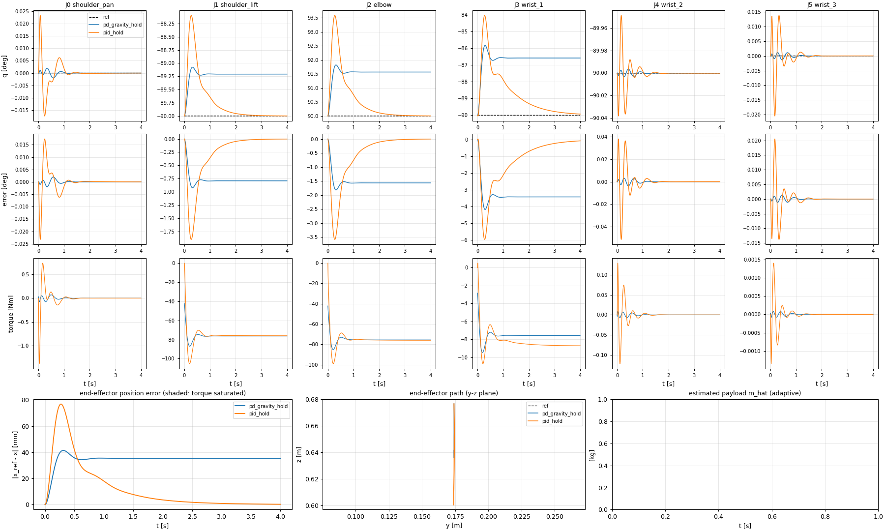

# 2. PD + 重力補償 — モデルを少しだけ使い、安定性を証明する

> **準備**: [起動・操作マニュアル](START_HERE.md) の 3〜4 章の手順で、**端末 1** でシミュレーションを起動し（`ros2 launch ur10e_control_lab lab.launch.py`）、
> **端末 2** で `cd ~/sandbox_for_claude/ur10e_control_lab_ws && source install/setup.bash` を済ませておきます。
> 特に断りがなければ、この章のコマンドは端末 2 で実行します。`offline_sim` と `plot_log` は Gazebo を起動していなくても実行できます。
> 終わったら端末 1 で `Ctrl+C`。動きがおかしくなったら `ros2 param set /control_lab reference hold` → `ros2 param set /control_lab controller pd_gravity` で初期姿勢の保持に戻せます。

## 2.1 この章で学ぶこと

- モデルの一部（重力項 g(q)）だけを使う制御
- **リアプノフの方法**による安定性の証明（ロボット制御の理論で最も重要な道具）
- 「モデルの重力」と「実際の重力」がずれていると、どうなるか

## 2.2 理論

有本・高木（1981）による制御則:

```
τ = Kp (q_ref − q) + Kd (q̇_ref − q̇) + g(q)
```

PID の I 項が「時間をかけて探していた」重力トルクを、モデルから直接計算して打ち消します。

### リアプノフ関数による安定性の証明（静止目標 q̇_ref = 0 のとき）

誤差 e = q_ref − q に対し、エネルギーのような関数

```
V = ½ q̇ᵀ M(q) q̇  +  ½ eᵀ Kp e
    （運動エネルギー）  （仮想ばねのエネルギー）
```

を考えます。V ≥ 0 で、V = 0 となるのは q̇ = 0 かつ e = 0 のときだけです。V を時間微分し、運動方程式と制御則を代入すると

```
V̇ = q̇ᵀ M q̈ + ½ q̇ᵀ Ṁ q̇ − q̇ᵀ Kp e
  = q̇ᵀ (τ − C q̇ − g) + ½ q̇ᵀ Ṁ q̇ − q̇ᵀ Kp e
  = q̇ᵀ (Kp e − Kd q̇) + ½ q̇ᵀ (Ṁ − 2C) q̇ − q̇ᵀ Kp e
  = −q̇ᵀ Kd q̇  ≤ 0                    （Ṁ − 2C は歪対称なので中央の項は 0）
```

V は増えないので、系は安定です。さらに LaSalle の不変性原理から、q̇ ≡ 0 が続くのは e = 0 のときだけなので、
**Kp, Kd が正である限り、どんなゲインでも大域的に漸近安定**になります。
「ゲインを上げすぎると不安定になる」ことがない、というのは強い性質です（ただし連続時間の理論の話です。離散時間では 1 章の課題 3 のように不安定になりえます）。

> この性質「Ṁ − 2C が歪対称」は [test_lab.py](../src/ur10e_control_lab/test/test_lab.py) の `test_skew_symmetry` で数値的に確認しています。

## 2.3 コードを読む

[controllers/pd_gravity.py](../src/ur10e_control_lab/ur10e_control_lab/controllers/pd_gravity.py) — 本体はたった 2 行:

```python
g = self.model.gravity(q)
tau = self.kp * (ref.q - q) + self.kd * (ref.qd - qd) + g
```

## 2.4 実験

### 実験 2-1: モデルが正確なとき

```bash
ros2 launch ur10e_control_lab lab.launch.py          # 起動直後の制御則がこれ
```

rqt_plot で誤差を見ると、ほぼ 0 のまま静止します（PID のような「垂れてから戻る」動きがない）。

### 実験 2-2: 負荷を知らないとき（モデル誤差）

```bash
ros2 param set /control_lab model_payload_mass 0.0     # 制御器のモデルから負荷 5 kg を消す
```

アームが少し垂れ下がり、そのまま止まります。I 項がないので、重力の誤差分 Δg に対して e = Δg / Kp の定常偏差が残ります。

```bash
ros2 run ur10e_control_lab offline_sim -c pd_gravity pid -r hold --duration 4 --set model_payload_mass=0.0
```



参考結果: 負荷を知らない PD＋重力補償の最終誤差は最大 **3.4°**（wrist_1）、手先で約 **35 mm** 垂れたままです。
PID は時間をかけて 0.07° まで戻ります。

```bash
ros2 param set /control_lab model_payload_mass 5.0     # 元に戻す
```

### 実験 2-3: 軌道追従

```bash
ros2 param set /control_lab reference sine
ros2 run ur10e_control_lab offline_sim -c pid pd_gravity computed_torque -r sine
```

PD＋重力補償の手先誤差 RMS は約 9 mm で、PID（約 17 mm）より良いものの、計算トルク法（約 1.7 mm）には及びません。
重力は補償していますが、**慣性力 M(q)q̈ を補償していない**ので、加速しようとするたびに遅れます。

## 2.5 考察課題

1. 実験 2-2 の定常偏差は、肩・肘・wrist_1 のどこが一番大きいですか？ g の誤差（0 章で計算した約 34 Nm など）と Kp の値から見積もってみましょう。
2. 「PD＋重力補償＋I 項」にしたら定常偏差はどうなりますか？ そのときリアプノフの証明はそのまま使えるでしょうか？
3. V の式で Kp を「ばね」とみなしました。では Kd は物理的に何に相当しますか？

→ 次は [3. 計算トルク法](03_computed_torque.md)
