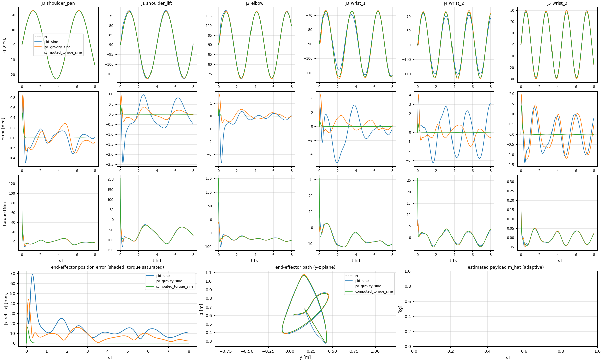
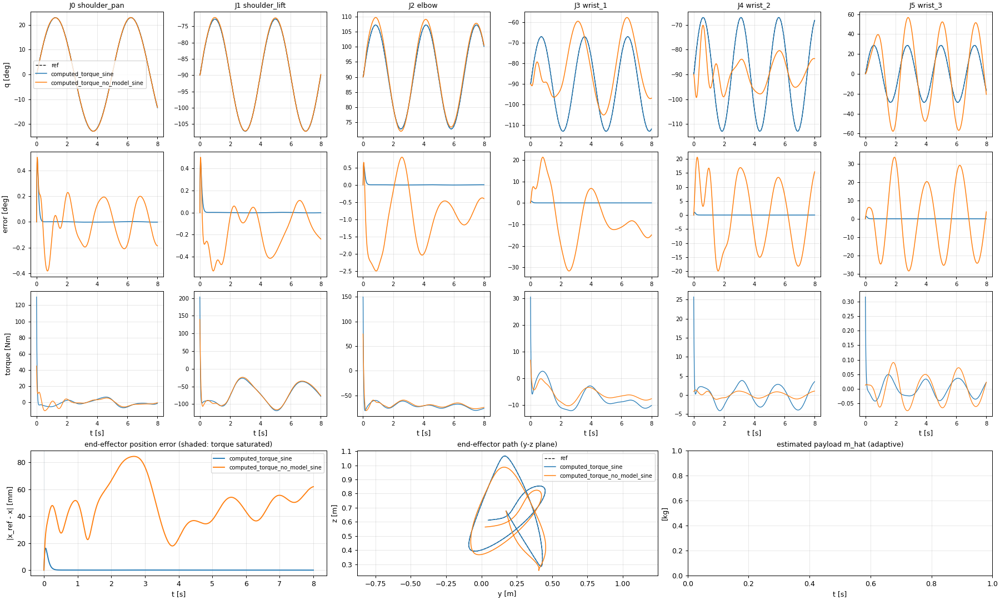

# 3. 計算トルク法 — 非線形なロボットを線形システムに変える

> **準備**: [起動・操作マニュアル](START_HERE.md) の 3〜4 章の手順で、**端末 1** でシミュレーションを起動し（`ros2 launch ur10e_control_lab lab.launch.py`）、
> **端末 2** で `cd ~/sandbox_for_claude/ur10e_control_lab_ws && source install/setup.bash` を済ませておきます。
> 特に断りがなければ、この章のコマンドは端末 2 で実行します。`offline_sim` と `plot_log` は Gazebo を起動していなくても実行できます。
> 終わったら端末 1 で `Ctrl+C`。動きがおかしくなったら `ros2 param set /control_lab reference hold` → `ros2 param set /control_lab controller pd_gravity` で初期姿勢の保持に戻せます。

## 3.1 この章で学ぶこと

- **フィードバック線形化**: モデルを使って非線形性を打ち消す考え方
- 物理的な意味（固有角振動数 ωn、減衰比 ζ）を持つゲイン設計
- 目標加速度の**フィードフォワード**の効果
- モデル誤差への弱さ（モデルベース制御の宿命）

## 3.2 理論

運動方程式 `M(q)q̈ + C(q,q̇)q̇ + g(q) = τ` に対して、新しい入力 v を使って

```
τ = M(q) v + C(q,q̇) q̇ + g(q)
```

とします。代入すると `M(q) q̈ = M(q) v`、M は正則なので

```
q̈ = v
```

モデルが正確なら、6 関節が互いに独立な**二重積分器**になります（非線形性も関節間の干渉も消える）。
あとは線形制御の知識で v を設計すればよく:

```
v = q̈_ref + Kd (q̇_ref − q̇) + Kp (q_ref − q)
 ⇒ 誤差 e = q_ref − q は  ë + Kd ė + Kp e = 0
```

これは「質量 1・ばね Kp・ダンパ Kd」の 2 次系です。`Kp = ωn²`, `Kd = 2ζωn` と選べば、
**どの関節も、どの姿勢でも同じ応答**（固有角振動数 ωn、減衰比 ζ）になります。

| ζ | 応答 |
|---|---|
| < 1 | 振動しながら収束（オーバーシュートあり） |
| = 1 | 臨界減衰（最速でオーバーシュートなし） |
| > 1 | 過減衰（ゆっくり） |

## 3.3 コードを読む

[controllers/computed_torque.py](../src/ur10e_control_lab/ur10e_control_lab/controllers/computed_torque.py):

```python
v = qdd_ff + self.kd * ed + self.kp * e        # 外側のループ: 線形な PD + フィードフォワード
M = self.model.mass_matrix(q)
tau = M @ v + self.model.coriolis(q, qd) + self.model.gravity(q)   # 内側: 逆動力学
```

ゲインは YAML で物理量として指定します:

```yaml
computed_torque:
  wn: 20.0      # [rad/s]
  zeta: 1.0
  feedforward: true
```

PID では関節ごとに桁の違うゲインが必要でしたが、ここでは全関節共通で `wn: 20` です。
**慣性の違いは M(q) が吸収している**からです。

## 3.4 実験

### 実験 3-1: PID・PD＋重力補償との比較

```bash
ros2 param set /control_lab controller computed_torque
ros2 param set /control_lab reference sine
# Gazebo で順に比較（約 40 秒）
./scripts/compare_in_gazebo.sh sine 8 pid pd_gravity computed_torque
```



参考結果（手先誤差 RMS）: PID 17 mm → PD＋重力補償 9 mm → **計算トルク法 1.7 mm**

### 実験 3-2: ωn と ζ を変える

```bash
ros2 run ur10e_control_lab offline_sim -c computed_torque -r step --set controllers.computed_torque.zeta=0.3
ros2 run ur10e_control_lab offline_sim -c computed_torque -r step --set controllers.computed_torque.zeta=1.0
ros2 run ur10e_control_lab offline_sim -c computed_torque -r step --set controllers.computed_torque.wn=40
```

ζ = 0.3 ではすべての関節が同じように振動します（関節ごとのばらつきがない）。
wn = 40 は速くなりますが、ステップの瞬間のトルクが増えて飽和しやすくなります。

### 実験 3-3: フィードフォワードの効果

```bash
ros2 run ur10e_control_lab offline_sim -c computed_torque -r sine --set controllers.computed_torque.feedforward=false
```

q̈_ref を使わないと、誤差が出てから反応するので遅れが増えます。

### 実験 3-4: モデル誤差（最重要）

```bash
ros2 param set /control_lab model_payload_mass 0.0
# またはオフラインで
ros2 run ur10e_control_lab offline_sim -c computed_torque computed_torque_no_model -r sine
```



参考結果: 負荷を知らないと、手首の誤差 RMS は **0.1° → 13〜18°** に悪化します。手先誤差は 1.7 mm → 49 mm です。

なぜ手首がこれほど悪化するのでしょうか？ 実際の q̈ は

```
q̈ = M_true⁻¹ (M̂ v + ...)  ≈  (M̂ / M_true) v
```

で、wrist_3 では M̂/M_true ≈ 0.00034 / 0.0087 ≈ **1/25** です。設計した ωn = 20 rad/s が、実際には
√(400/25) = 4 rad/s 相当に落ちてしまいます。「線形化したつもりが、できていない」状態です。

## 3.5 考察課題

1. 実験 3-4 で、肩・肘の誤差はそれほど悪化しません。肩・肘での M̂/M_true の比を 0 章の数値から計算し、手首と比べてください。
2. ステップ目標（不連続な目標）に計算トルク法を使うと大きなトルクが出ます。実用上はどう対処すべきでしょうか？（ヒント: `quintic`）
3. 計算トルク法の計算量は PID より多いです。毎周期 M(q) を計算する代わりに、ある姿勢での M を固定して使ったら何が起きるでしょうか？ `template.py` で試してみましょう（10 章）。
4. この章の誤差方程式 `ë + Kd ė + Kp e = 0` は線形です。ということは、Kp, Kd を最適化の枠組みで決めることもできそうです → 次章 LQR へ。

→ 次は [4. LQR](04_lqr.md)
