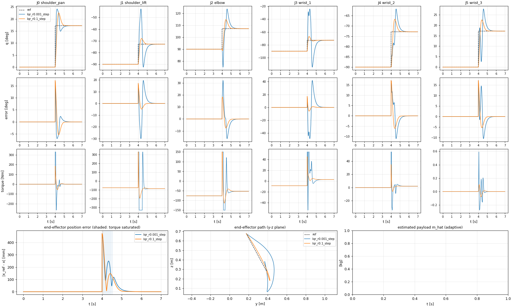
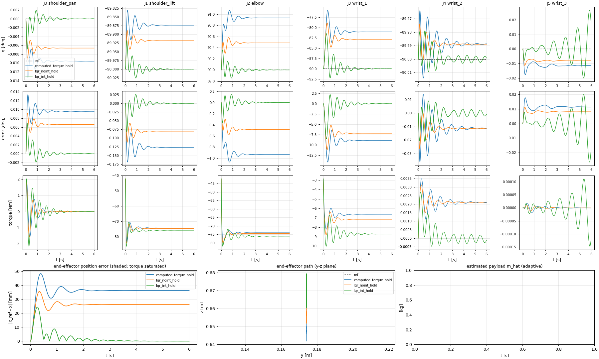

# 4. LQR — 「何を重視するか」からゲインを最適に決める

> **準備**: [起動・操作マニュアル](START_HERE.md) の 3〜4 章の手順で、**端末 1** でシミュレーションを起動し（`ros2 launch ur10e_control_lab lab.launch.py`）、
> **端末 2** で `cd ~/sandbox_for_claude/ur10e_control_lab_ws && source install/setup.bash` を済ませておきます。
> 特に断りがなければ、この章のコマンドは端末 2 で実行します。`offline_sim` と `plot_log` は Gazebo を起動していなくても実行できます。
> 終わったら端末 1 で `Ctrl+C`。動きがおかしくなったら `ros2 param set /control_lab reference hold` → `ros2 param set /control_lab controller pd_gravity` で初期姿勢の保持に戻せます。

## 4.1 この章で学ぶこと

- 状態空間モデル `ẋ = Ax + Bu` と状態フィードバック `u = −Kx`
- 評価関数の重み Q（状態）と R（入力）のトレードオフ
- Riccati 方程式によるゲイン計算
- 非線形なロボットに LQR を使う 2 つの方法（フィードバック線形化後／平衡点まわりの線形化）
- 積分動作の追加と、モデル誤差による不安定化

## 4.2 理論

線形システム `ẋ = Ax + Bu` に対して、評価関数

```
J = ∫₀^∞ (xᵀ Q x + uᵀ R u) dt
      誤差の大きさ   入力の大きさ
```

を最小にする制御は `u = −Kx` という線形フィードバックになり、K は代数 Riccati 方程式

```
AᵀP + PA − PBR⁻¹BᵀP + Q = 0,     K = R⁻¹BᵀP
```

の解 P から計算できます（`scipy.linalg.solve_continuous_are`）。
**閉ループは必ず安定**で、さらに位相余裕 60° 以上・ゲイン余裕無限大という強いロバスト性も持ちます（連続時間・状態が全部測れる場合）。

### 方法 A: フィードバック線形化 + LQR（`mode: feedback_linearized`、既定）

計算トルク法で `q̈ = v` にしたあと、各関節の二重積分器（＋積分器）に LQR を使います:

```
状態 x = [∫ẽ, ẽ, ė̃]   (ẽ = q − q_ref)       入力 u = v − q̈_ref
A = [[0,1,0],[0,0,1],[0,0,0]],   B = [0,0,1]ᵀ
```

3 章の Kp, Kd を「勘」ではなく Q, R から決める方法といえます。

### 方法 B: 平衡点まわりの線形化（`mode: linearized_model`）

目標姿勢 q₀ のまわりで運動方程式を 1 次近似すると（速度が小さいとして C 項を無視）:

```
M(q₀) δq̈ + G₀ δq = δτ,   G₀ = ∂g/∂q |q₀
⇒ A = [[0, I], [−M⁻¹G₀, 0]],  B = [[0], [M⁻¹]]     （12 状態・6 入力）
```

ゲイン K は 6×12 の行列になり、**関節間の結合を考慮したフィードバック**（ある関節の誤差を別の関節のトルクで補正する）になります。
姿勢が変わると線形化をやり直します（ゲインスケジューリング）。

## 4.3 コードを読む

[controllers/lqr.py](../src/ur10e_control_lab/ur10e_control_lab/controllers/lqr.py)

```python
def lqr_gain(A, B, Q, R):
    P = solve_continuous_are(A, B, Q, R)
    return np.linalg.solve(R, B.T @ P)
```

- `_design_double_integrator()`: 方法 A。関節ごとに 3×3 の Riccati を解く（起動時に 1 回）
- `_design_linearized()`: 方法 B。`model.gravity_jacobian()` で ∂g/∂q を数値微分し、12×12 の Riccati を解く

ゲインの数値を見てみましょう:

```bash
python3 -c "
from ur10e_control_lab.controllers.lqr import lqr_gain
import numpy as np
A=np.array([[0,1,0],[0,0,1],[0,0,0.]]); B=np.array([[0],[0],[1.]])
K=lqr_gain(A,B,np.diag([8000,400,1]),np.array([[0.001]]))
print('K =',K.round(1),' 極 =',np.linalg.eigvals(A-B@K).round(1))"
```
```
K = [[2828.4  831.8   51.6]]  極 = [ -4.6+0.j  -23.5+8.j  -23.5-8.j]
```

## 4.4 実験

### 実験 4-1: Q と R のトレードオフ

```bash
ros2 run ur10e_control_lab offline_sim -c lqr -r step --set controllers.lqr.r=0.001
ros2 run ur10e_control_lab offline_sim -c lqr -r step --set controllers.lqr.r=0.1
```



| r | 応答 | 最大トルク（shoulder_pan / wrist_1） | 飽和率 |
|---|---|---|---|
| 0.001（既定） | 速い・強い | 330 Nm / 54 Nm（どちらも上限） | 6.9 % |
| 0.1 | ゆっくり・穏やか | 約 200 Nm / 約 50 Nm | 0.6 % |

R を 100 倍にすると「入力を使うコスト」が上がり、控えめな制御になります。
ただし R を小さくしすぎると、LQR が想定していない**トルク飽和**に当たり、かえって性能が落ちることがあります
（LQR は制約を扱えない → 8 章 MPC の動機）。

### 実験 4-2: 積分動作の効果（モデル誤差あり）

```bash
ros2 run ur10e_control_lab offline_sim -c computed_torque lqr -r hold --set model_payload_mass=0.0 --set controllers.lqr.q_integral=0
ros2 run ur10e_control_lab offline_sim -c lqr -r hold --set model_payload_mass=0.0
```



| 制御器（負荷を知らない） | 最終誤差 max |
|---|---|
| 計算トルク法 | 8.9° |
| LQR（積分なし） | 7.2° |
| LQR（積分あり） | **0.02°** |

### 実験 4-3: 積分動作 × モデル誤差 → 不安定化

```bash
ros2 run ur10e_control_lab offline_sim -c lqr -r sine --set model_payload_mass=0.0
```

静止（hold）では役に立った積分動作ですが、動かすと wrist_3 が発散的に振れます（誤差 RMS が 200° 以上）。

理由を考えましょう。wrist_3 では実際の慣性が想定の約 25 倍なので、`q̈ = α·v`（α ≈ 1/25）になります。
積分付きの閉ループ特性方程式は `s³ + α·k_v s² + α·k_p s + α·k_i = 0` で、Routh の安定判別法から安定条件は

```
(α·k_v)(α·k_p) > α·k_i   ⇔   α > k_i / (k_v·k_p) = 2828 / (51.6 × 832) ≈ 0.066
```

α ≈ 0.04 なので**不安定**です。積分を強くするほど、モデル誤差への耐性が下がることが分かります。

### 実験 4-4: 方法 A と方法 B の比較

```bash
ros2 run ur10e_control_lab offline_sim -c lqr lqr_linearized computed_torque -r sine
./scripts/compare_in_gazebo.sh sine 8 lqr lqr_linearized
```

参考結果（手先誤差 RMS）: 方法 A 1.1 mm、方法 B 3.9 mm。方法 B は C 項や姿勢変化を無視した近似なので、大きく動く軌道では方法 A に劣ります。
一方、方法 B は「計算トルク法のような毎周期の逆動力学計算が不要」という実装上の利点があります。

## 4.5 考察課題

1. Q と R を両方 10 倍にすると K はどう変わりますか？ 計算して確かめ、理由を説明してください。
2. 実験 4-3 の Routh 条件を使い、wrist_3 が安定になる `q_integral` の上限を見積もり、オフラインで確かめてください。
3. 方法 B の `relinearize_period` を大きく（例: 10 秒）すると、sine 追従はどうなりますか？
4. 「LQR は最適」と言いますが、何に対して最適なのでしょうか？ 実験 4-1 の飽和の例を踏まえて考えてください。

→ 次は [5. スライディングモード制御](05_sliding_mode.md)
