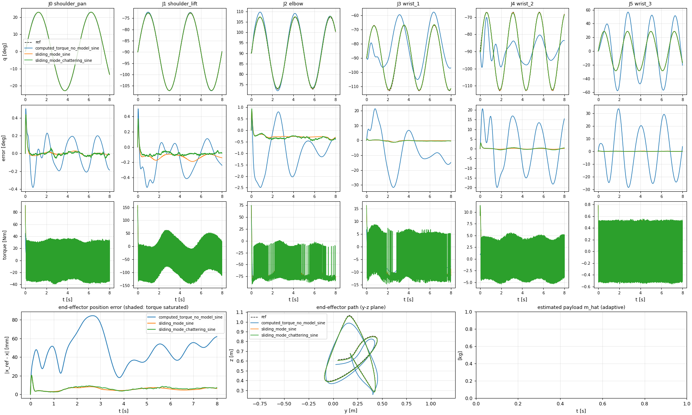

# 5. スライディングモード制御 — モデル誤差を「力ずく」で抑え込む

> **準備**: [起動・操作マニュアル](START_HERE.md) の 3〜4 章の手順で、**端末 1** でシミュレーションを起動し（`ros2 launch ur10e_control_lab lab.launch.py`）、
> **端末 2** で `cd ~/sandbox_for_claude/ur10e_control_lab_ws && source install/setup.bash` を済ませておきます。
> 特に断りがなければ、この章のコマンドは端末 2 で実行します。`offline_sim` と `plot_log` は Gazebo を起動していなくても実行できます。
> 終わったら端末 1 で `Ctrl+C`。動きがおかしくなったら `ros2 param set /control_lab reference hold` → `ros2 param set /control_lab controller pd_gravity` で初期姿勢の保持に戻せます。

## 5.1 この章で学ぶこと

- ロバスト制御の考え方: 「モデルは不正確」という前提で設計する
- 滑り面（スライディング面）と、そこへ状態を押し付ける不連続制御
- **チャタリング**と、境界層によるその抑制

## 5.2 理論

### 滑り面

誤差 ẽ = q − q_ref に対して

```
s = ė̃ + Λ ẽ          （Λ > 0）
```

を定義します。もし s = 0 を保てれば、ė̃ = −Λẽ なので誤差は時定数 1/Λ で指数的に 0 へ収束します。
つまり「6 関節 × 2 次の追従問題」を「s を 0 にする 1 次の問題」に置き換えます。

### 制御則

基準速度 `q̇_r = q̇_ref − Λẽ`、基準加速度 `q̈_r = q̈_ref − Λė̃` を使うと `s = q̇ − q̇_r` と書けます。制御則は

```
τ = M̂ q̈_r + Ĉ(q,q̇) q̇_r + ĝ   −  K_d s  −  η · sgn(s)
    └─ モデル（誤差を含む） ─┘    減衰     不連続なロバスト項
```

モデル誤差による残差を ΔF とすると、閉ループは `M ṡ + (C + K_d) s = ΔF − η sgn(s)` となり、
**η > |ΔF|** なら s は有限時間で 0 に到達し、そこにとどまります。モデル誤差の「上限」さえ分かれば、正確なモデルは不要です。

### チャタリングと境界層

sgn(s) は s = 0 の前後で ±η が瞬時に切り替わります。実際には制御周期（2 ms）ごとにしか切り替えられないので、
s は 0 の周りで細かく行き来し、トルクが高周波で振動します（**チャタリング**）。実機ではモーター・減速機の摩耗や騒音、
モデル化していない共振の励起につながります。

対策として sgn(s) を飽和関数 `sat(s/φ)` に置き換えます（φ = 境界層の厚さ）。
|s| < φ の内側では線形な制御になるので滑らかになりますが、その代わりに s は 0 ではなく |s| < φ の範囲に収まるだけになります。

## 5.3 コードを読む

[controllers/sliding_mode.py](../src/ur10e_control_lab/ur10e_control_lab/controllers/sliding_mode.py):

```python
s = ed + self.lam * e
qd_r = ref.qd - self.lam * e
qdd_r = ref.qdd - self.lam * ed
tau_model = (self.model.mass_matrix(q) @ qdd_r
             + self.model.coriolis_times(q, qd, qd_r)       # C(q,q̇) q̇_r（q̇ ではない！）
             + self.model.gravity(q))
sat = np.where(self.phi > 0, np.clip(s / self.phi, -1.0, 1.0), np.sign(s))
tau = tau_model - self.kd * s - self.eta * sat
```

**`coriolis_times` について**: KDL は `C(q,q̇)q̇` しか返しませんが、ここでは `C(q,q̇)q̇_r` が必要です。
`C(q,q̇)q̇` が q̇ の対称 2 次形式 h(q̇,q̇) であることを利用し、偏極恒等式
`h(a,b) = [h(a+b,a+b) − h(a−b,a−b)]/4` で計算しています（[robot_model.py](../src/ur10e_control_lab/ur10e_control_lab/robot_model.py)）。

YAML では `model_payload_mass: 0.0` を指定しており、この制御器は**常に負荷を知らないモデル**を使います。

## 5.4 実験

### 実験 5-1: 負荷を知らなくても追従できる

```bash
ros2 param set /control_lab reference sine
ros2 param set /control_lab controller computed_torque_no_model   # 負荷を知らない計算トルク法
ros2 param set /control_lab controller sliding_mode               # 同じく負荷を知らないモデル + ロバスト項
```

```bash
ros2 run ur10e_control_lab offline_sim -c computed_torque_no_model sliding_mode sliding_mode_chattering -r sine
```



| 制御器（どれも負荷を知らない） | 手先誤差 RMS | 手首の誤差 RMS |
|---|---|---|
| 計算トルク法 | 49 mm | 13〜18° |
| スライディングモード（φ = 0.05） | **6 mm** | 0.1〜0.4° |
| スライディングモード（φ = 0、sgn） | 7 mm | 0.1〜0.5° |

### 実験 5-2: チャタリングを見る

上の図の 3 段目（トルク）で、緑（φ = 0）のトルクが帯状に塗りつぶされているのがチャタリングです。
誤差はほとんど変わらないのに、トルクは毎周期 ±η の幅で切り替わっています。

Gazebo では次のようにして観察できます:

```bash
ros2 param set /control_lab controller sliding_mode_chattering
ros2 run rqt_plot rqt_plot /control_lab/command/effort[1] /control_lab/info/s/data[1]
```

### 実験 5-3: η と φ を変える

```bash
ros2 run ur10e_control_lab offline_sim -c sliding_mode -r sine --set "controllers.sliding_mode.eta=[5,10,5,2,1,0.1]"
ros2 run ur10e_control_lab offline_sim -c sliding_mode -r sine --set controllers.sliding_mode.boundary_layer=0.5
```

η が小さすぎるとモデル誤差に負け、φ が大きすぎると誤差が残ります。

## 5.5 考察課題

1. 負荷 5 kg を知らないことによる重力トルクの誤差は、肩・肘で約 34 Nm でした。YAML の η（肩 60 Nm）はこれを上回っていますか？
   kd·s の項も誤差を抑えることに注意して、η をどこまで下げられるか試してください。
2. φ を大きくしていくと、スライディングモード制御は何という制御に近づきますか？（ヒント: sat(s/φ) ≈ s/φ）
3. 実機でチャタリングを避ける方法は、境界層以外に何がありますか？（キーワード: スーパーツイスティング、高次スライディングモード）

→ 次は [6. 適応制御](06_adaptive.md)
