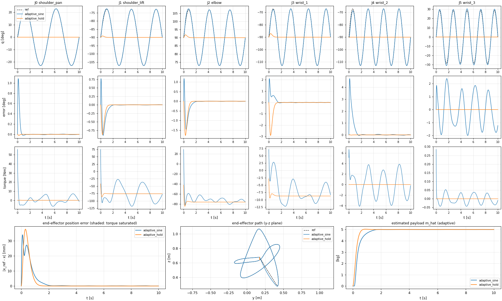

# 6. 適応制御 — 未知のパラメータを動かしながら推定する

> **準備**: [起動・操作マニュアル](START_HERE.md) の 3〜4 章の手順で、**端末 1** でシミュレーションを起動し（`ros2 launch ur10e_control_lab lab.launch.py`）、
> **端末 2** で `cd ~/sandbox_for_claude/ur10e_control_lab_ws && source install/setup.bash` を済ませておきます。
> 特に断りがなければ、この章のコマンドは端末 2 で実行します。`offline_sim` と `plot_log` は Gazebo を起動していなくても実行できます。
> 終わったら端末 1 で `Ctrl+C`。動きがおかしくなったら `ros2 param set /control_lab reference hold` → `ros2 param set /control_lab controller pd_gravity` で初期姿勢の保持に戻せます。

## 6.1 この章で学ぶこと

- ロボットの動力学が「物理パラメータについて線形」という重要な性質
- 回帰行列（リグレッサ）Y を使った Slotine-Li 型の適応制御
- リアプノフ関数から**適応則（パラメータの更新式）を導く**方法
- 「追従誤差の収束」と「パラメータの収束」の違い（持続的励振）

## 6.2 理論

### 動力学のパラメータ線形性

ロボットの運動方程式は、質量・重心・慣性モーメントなどの物理パラメータ θ について線形に書けます:

```
M(q) q̈ + C(q,q̇) q̇ + g(q) = Y(q, q̇, q̈) θ
```

非線形なのは q, q̇, q̈ についてだけで、パラメータについては線形です。
この性質のおかげで、未知のパラメータをオンラインで推定できます。

### 今回の設定: 手先負荷の質量 m だけが未知

負荷を tool0 から offset（既定 [0, 0, 0.1] m）の位置にある質点とみなし、その点のヤコビアンを Jp (3×6) とすると、負荷によるトルクは

```
τ_payload = m · Jpᵀ (Jp q̈ + J̇p q̇ + [0, 0, g]ᵀ)
             = Y · m      （Y は 6×1 の回帰ベクトル）
```

と書けます（[test_lab.py](../src/ur10e_control_lab/test/test_lab.py) の `test_payload_regressor` で、重力部分が厳密に一致することを確認しています）。

### 制御則と適応則

5 章と同じ s, q̇_r, q̈_r を使って

```
τ = τ_model(負荷なし) + Y(q, q̇, q̇_r, q̈_r) m̂ − K_d s       … 制御則
ṁ̂ = −Γ Yᵀ s                                                  … 適応則
```

**適応則の導き方**: リアプノフ関数の候補

```
V = ½ sᵀ M(q) s  +  ½ Γ⁻¹ (m̂ − m)²
```

を微分すると（Ṁ − 2C の歪対称性を使って）

```
V̇ = −sᵀ K_d s  +  (m̂ − m)(Yᵀ s + Γ⁻¹ ṁ̂)
```

第 2 項は符号が分からず厄介ですが、ṁ̂ = −Γ Yᵀ s と選べば**ちょうど 0 になります**。残る V̇ = −sᵀK_d s ≤ 0 から、s → 0（追従誤差 → 0）が保証されます。
「安定性の証明が成り立つように更新則を決める」というのが、リアプノフ法に基づく適応制御の考え方です。

### 注意: パラメータが真値に収束するとは限らない

上の証明が保証するのは s → 0 だけです。m̂ → m となるには、Y が十分にさまざまな値をとる（**持続的励振**, persistent excitation）必要があります。
今回は未知数が 1 つで、重力の項 Jpᵀ[0,0,g] が静止中も 0 にならないので、静止していても収束します。
負荷の重心位置など未知数を増やすと、静止中は見分けがつかない組み合わせが生じ、運動による励振が必要になります。

## 6.3 コードを読む

[controllers/adaptive.py](../src/ur10e_control_lab/ur10e_control_lab/controllers/adaptive.py):

```python
def regressor(self, q, qd, qd_r, qdd_r, h=1e-6):
    Jp = self.model.point_jacobian(q, self.offset)
    Jp_dot = (self.model.point_jacobian(q + qd * h, self.offset) - Jp) / h   # J̇p を数値微分
    a = Jp @ qdd_r + Jp_dot @ qd_r + np.array([0.0, 0.0, 9.81])
    return Jp.T @ a

...
tau = tau_model + Y * self.m_hat - self.kd * s
self.m_hat += -self.gamma * float(Y @ s) * dt              # 適応則（オイラー積分）
self.m_hat = float(np.clip(self.m_hat, self.m_min, self.m_max))   # 射影（物理的にありえない値を防ぐ）
```

## 6.4 実験

### 実験 6-1: 負荷の質量を推定する

```bash
ros2 param set /control_lab controller adaptive
ros2 run rqt_plot rqt_plot /control_lab/info/m_hat/data[0]
```

制御器を切り替えた瞬間 m̂ = 0 から始まり、約 1〜2 秒で 5 kg 付近に収束します。

```bash
ros2 run ur10e_control_lab offline_sim -c adaptive -r sine --duration 10
```



参考結果: Gazebo で m̂ = 5.08 kg、オフラインで 5.00 kg（真値 5.0 kg）。手先誤差 RMS は 6〜7 mm で、負荷を知らない計算トルク法（49 mm）より大幅に改善します。

### 実験 6-2: 負荷を変えても追いつく

起動条件を変えるので、**端末 1 で `Ctrl+C` してシミュレーションを終了してから**、端末 1 で次を実行します:

```bash
# 負荷 10 kg の UR10e で起動（制御器のモデルは負荷 0 のまま。適応制御が推定する）
ros2 launch ur10e_control_lab lab.launch.py payload_mass:=10.0 controller:=adaptive reference:=sine
```

端末 2 で `ros2 run rqt_plot rqt_plot /control_lab/info/m_hat/data[0]` を開くと、m̂ が 10 kg 付近へ収束していく様子が見えます
（オフラインでの参考結果: t = 1 s で 9.4 kg、3 s で 10.0 kg）。
実験が終わったら、端末 1 で `Ctrl+C` → 通常の `ros2 launch ur10e_control_lab lab.launch.py` で起動し直してください。

### 実験 6-3: 適応ゲイン Γ

```bash
ros2 run ur10e_control_lab offline_sim -c adaptive -r sine --set controllers.adaptive.gamma=1
ros2 run ur10e_control_lab offline_sim -c adaptive -r sine --set controllers.adaptive.gamma=50
```

参考結果（m̂ の推移）:

| Γ | t = 1 s | 2 s | 5 s |
|---|---|---|---|
| 1 | 1.85 | 3.61 | 4.88 |
| 5（既定） | ほぼ 5.0（約 1.5 s で収束） | 5.0 | 5.0 |
| 50 | 5.0 | 4.99 | 5.0 |

Γ を大きくすると収束は速くなりますが、ノイズがある場合は m̂ がノイズで揺さぶられます（`position_noise_std` を加えて試してみましょう）。

## 6.5 考察課題

1. 適応則 ṁ̂ = −ΓYᵀs の符号を逆にするとどうなるでしょうか？ 予想してから試してください（Gazebo では暴れる可能性があるので、まずオフラインで）。
2. `payload_offset` を実際と違う値（例: [0, 0, 0.3]）にすると、m̂ は何 kg に収束しますか？ なぜでしょうか？
3. センサノイズ（`--set sensor.position_noise_std=0.002 -e kf`）を加えたとき、m̂ はどう振る舞いますか？ 適応制御の弱点としてよく知られる「パラメータドリフト」と、その対策（σ 修正、射影）を調べてみましょう。
4. スライディングモード（5 章）と適応制御は、どちらも「負荷を知らない」状況に対処しました。両者の考え方の違いを説明してください。

→ 次は [7. インピーダンス制御](07_impedance.md)
