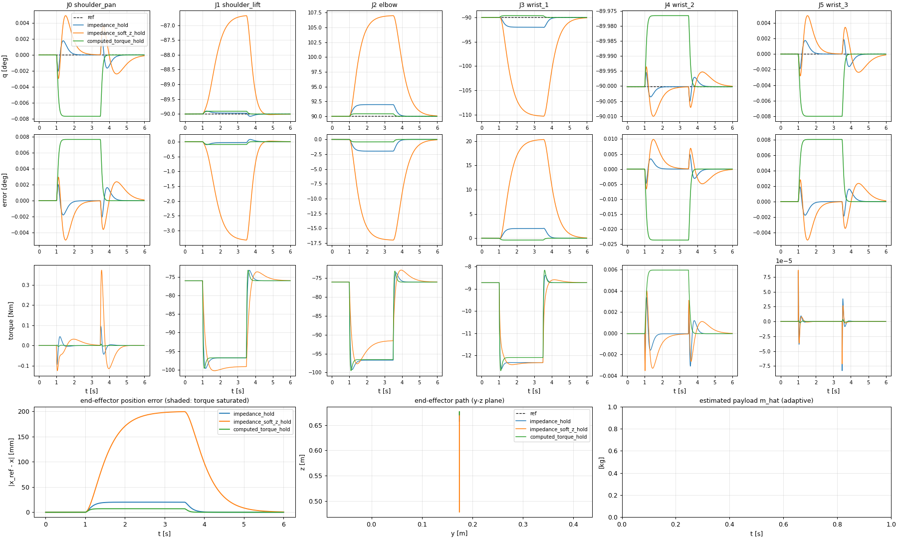
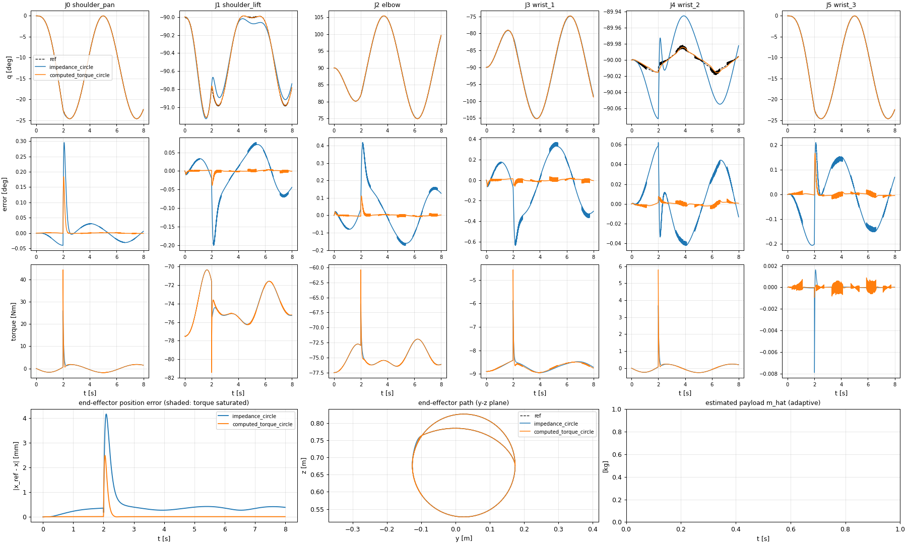

# 7. インピーダンス制御 — 位置ではなく「柔らかさ」を制御する

> **準備**: [起動・操作マニュアル](START_HERE.md) の 3〜4 章の手順で、**端末 1** でシミュレーションを起動し（`ros2 launch ur10e_control_lab lab.launch.py`）、
> **端末 2** で `cd ~/sandbox_for_claude/ur10e_control_lab_ws && source install/setup.bash` を済ませておきます。
> 特に断りがなければ、この章のコマンドは端末 2 で実行します。`offline_sim` と `plot_log` は Gazebo を起動していなくても実行できます。
> 終わったら端末 1 で `Ctrl+C`。動きがおかしくなったら `ros2 param set /control_lab reference hold` → `ros2 param set /control_lab controller pd_gravity` で初期姿勢の保持に戻せます。

## 7.1 この章で学ぶこと

- **タスク空間**（手先の位置・姿勢）での制御
- ヤコビアン転置 Jᵀ による「手先の力 → 関節トルク」の変換
- 外力に対する応答（剛性 K・減衰 D・慣性）を設計する考え方
- 手先から見た慣性 Λ(q) と、それに合わせた減衰の設計

## 7.2 理論

### なぜ「柔らかさ」なのか

位置制御は「目標位置からずれたら全力で戻す」制御です。人と協働するロボットや、部品の組み付け・研磨のように
**環境と接触する作業**では、硬すぎると大きな力が出て危険だったり、部品を壊したりします。
インピーダンス制御は、手先と目標の間に仮想的な**ばね（K）とダンパ（D）**をつなぎ、外力に対してどれだけ動くかを設計します。

### ヤコビアン転置

手先の速度は `ẋ = J(q) q̇`（J はヤコビアン）。仮想仕事の原理から、手先に力 F を出すための関節トルクは

```
τ = J(q)ᵀ F
```

です。逆運動学を解く必要がなく、計算が軽いのが特徴です。

### 制御則

手先の位置誤差 e_p と姿勢誤差 e_o（回転ベクトル）から 6 次元の仮想力を作ります:

```
F = K e + D ė,        e = [x_ref − x;  e_o],   ė = [ẋ_ref − ẋ;  −ω]
```

**シンプル版（`use_dynamics: false`）**:  `τ = JᵀF + g(q)`
（剛性制御・コンプライアンス制御とも呼ばれます）

**動力学補償版（`use_dynamics: true`、既定）**:

```
Λ(q) = (J M⁻¹ Jᵀ)⁻¹                               手先から見た慣性（タスク空間慣性行列）
τ = Jᵀ [Λ (ẍ_ref − J̇q̇) + F] + C q̇ + g
```

このとき外力 F_ext に対する手先の運動は

```
Λ ë + D ė + K e = F_ext        （質量-ばね-ダンパ系）
```

となり、静的な外力に対する変位は **e = F_ext / K** です。

### 減衰の設計

1 自由度の質量-ばね-ダンパ系 `m ë + d ė + k e = 0` の臨界減衰は `d = 2ζ√(mk)` です。
しかし Λ(q) は姿勢によって変わり、方向によって桁違いに異なります（手首まわりの回転は非常に軽い）。
固定の D を使うと、軽い方向で減衰が強すぎて、離散時間の制御が不安定になります。そこで毎周期

```
D = ζ (Λ^½ K^½ + K^½ Λ^½)
```

と Λ に合わせて D を作っています。

> 開発時の実話: 最初は「見かけの質量 10 kg」で固定の D を使っていたところ、wrist_3 のトルクが上限 54 Nm に張り付いて振動しました。
> wrist_3 の回転慣性は約 0.009 kg·m² しかなく、減衰の時定数 Λ/D が制御周期 2 ms より短くなっていたためです。

## 7.3 コードを読む

[controllers/impedance.py](../src/ur10e_control_lab/ur10e_control_lab/controllers/impedance.py):

```python
x, R = self.model.fk(q)
J = self.model.jacobian(q)
M = self.model.mass_matrix(q)
Lam = np.linalg.inv(J @ np.linalg.solve(M, J.T))
e = np.concatenate([ref.x - x, orientation_error(ref.R, R)])
ed = np.concatenate([ref.xd, np.zeros(3)]) - J @ qd
F = self.K @ e + self.damping(Lam) @ ed
tau = J.T @ (Lam @ a_ref + F) + self.model.coriolis(q, qd) + g
```

姿勢誤差は [robot_model.py](../src/ur10e_control_lab/ur10e_control_lab/robot_model.py) の `orientation_error()`（回転行列の差を回転ベクトルにする）で計算しています。

## 7.4 実験

### 実験 7-1: 手先を押す

起動中のシミュレーションをそのまま使う場合は、端末 2 で `ros2 param set /control_lab controller impedance` に切り替えるだけで構いません
（新しく起動する場合は、端末 1 で `ros2 launch ur10e_control_lab lab.launch.py controller:=impedance`）。

```bash
# 端末 2
ros2 param set /control_lab reference hold
ros2 param set /control_lab controller impedance
# 手先を下向きに 30 N で 3 秒押す
ros2 run ur10e_control_lab push --force 0 0 -30 --duration 3
# z だけ柔らかい設定に切り替えてもう一度
ros2 param set /control_lab controller impedance_soft_z
ros2 run ur10e_control_lab push --force 0 0 -30 --duration 3
# 横から押す（x, y は硬いまま）
ros2 run ur10e_control_lab push --force 30 0 0 --duration 3
```

手先の z 座標は rqt_plot で見られます:

```bash
ros2 run rqt_plot rqt_plot /control_lab/ee_pose/point/z /control_lab/ee_reference/point/z
```

オフラインでの比較:

```bash
ros2 run ur10e_control_lab offline_sim -c impedance impedance_soft_z computed_torque -r hold --push 1.0,2.5,0,0,-30
```



参考結果（−30 N で押したときの z 方向の変位）:

| 制御器 | K_z | 理論値 F/K | Gazebo | オフライン |
|---|---|---|---|---|
| `impedance` | 1500 N/m | 20 mm | 18.4 mm | 20.0 mm |
| `impedance_soft_z` | 150 N/m | 200 mm | 184 mm | 199 mm |
| `computed_torque`（参考: 位置制御） | — | — | — | 7 mm |

Gazebo の値が少し小さいのは、`push` が手先（tool0）ではなく wrist_3_link の重心に力を加えるためです（てこの腕が少し短い）。

### 実験 7-2: 手先で円を描く

```bash
ros2 param set /control_lab controller impedance
ros2 param set /control_lab reference circle
```

```bash
ros2 run ur10e_control_lab offline_sim -c impedance computed_torque pid -r circle
```



参考結果（手先誤差 RMS）: インピーダンス 0.7 mm、計算トルク法 0.3 mm、PID 16 mm。
インピーダンス制御は「硬さ」を自由に選べるぶん、位置の精度では計算トルク法に一歩譲ります（K を上げれば精度は上がりますが、柔らかさを失います）。

### 実験 7-3: 動力学補償の有無

```bash
ros2 run ur10e_control_lab offline_sim -c impedance -r circle --set controllers.impedance.use_dynamics=false
```

Λ ẍ_ref のフィードフォワードがないので、円の追従が遅れます。

## 7.5 考察課題

1. `stiffness_translational` を [3000, 3000, 3000] にすると、30 N で押したときの変位は何 mm になるはずですか？ 試して確かめてください。
2. `damping_ratio` を 0.2 にして押すと、どのような応答になりますか？ 離したときの動きにも注目してください。
3. 計算トルク法（位置制御）で 30 N 押したときの変位（約 7 mm、硬い）は、何によって決まっていますか？ 計算トルク法の「見かけの剛性」を ωn と Λ から見積もってみましょう。
4. 実際の協働ロボットでは、手首に力センサ（F/T センサ）を付けて外力を測ることが多いです。外力を測れると、制御則の何が変わり、どんな利点があるでしょうか？（キーワード: アドミッタンス制御、慣性の整形）

→ 次は [8. モデル予測制御](08_mpc.md)
