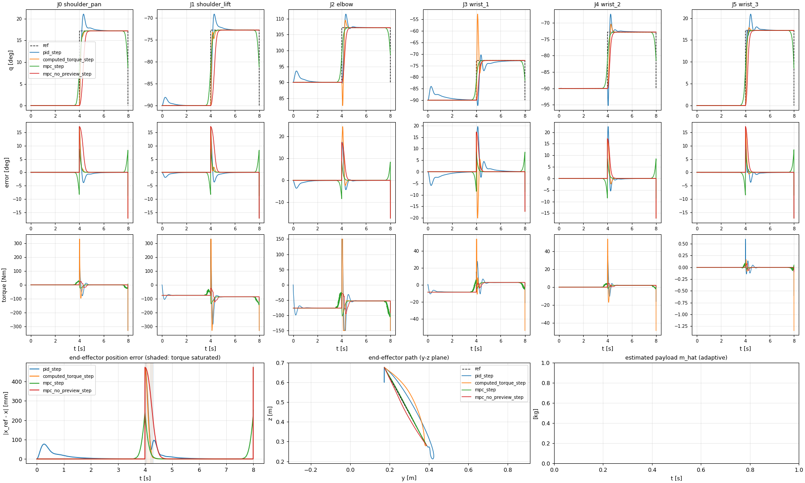

# 8. モデル予測制御（MPC）— 未来を予測し、制約の中で最適に動く

> **準備**: [起動・操作マニュアル](START_HERE.md) の 3〜4 章の手順で、**端末 1** でシミュレーションを起動し（`ros2 launch ur10e_control_lab lab.launch.py`）、
> **端末 2** で `cd ~/sandbox_for_claude/ur10e_control_lab_ws && source install/setup.bash` を済ませておきます。
> 特に断りがなければ、この章のコマンドは端末 2 で実行します。`offline_sim` と `plot_log` は Gazebo を起動していなくても実行できます。
> 終わったら端末 1 で `Ctrl+C`。動きがおかしくなったら `ros2 param set /control_lab reference hold` → `ros2 param set /control_lab controller pd_gravity` で初期姿勢の保持に戻せます。

## 8.1 この章で学ぶこと

- 予測モデルを使った**有限時間の最適制御**と Receding Horizon（後退ホライズン）の考え方
- **制約**（加速度・速度の上限）を直接扱えることの意味
- 目標軌道の**先読み**（プレビュー）の効果
- 二次計画問題（QP）とその解き方（ADMM）
- モデル誤差への対処（外乱オブザーバによるオフセットフリー MPC）

## 8.2 理論

### 問題設定

計算トルク法で各関節を二重積分器 `q̈ = a` に線形化し、離散時間（刻み dt）の予測モデル

```
x_{k+1} = A x_k + B a_k,     x = [q, q̇],   A = [[1, dt],[0, 1]],   B = [dt²/2, dt]ᵀ
```

を使います。毎周期、現在の状態 x₀ から N ステップ先までを予測し、次の最適化問題を解きます:

```
min    Σ_{k=1..N}  w_q (q_k − q_ref,k)²  +  w_v (q̇_k − q̇_ref,k)²  +  r a_{k−1}²
a₀..a_{N−1}
s.t.   |a_k| ≤ a_max            （加速度制約）
       |q̇_k| ≤ v_max            （速度制約）
```

解いた a₀, a₁, …, a_{N−1} のうち**最初の a₀ だけ**を使い、次の周期にまた解き直します（Receding Horizon）。

### QP として解く

予測位置・速度は入力列 U = [a₀ … a_{N−1}] の線形関数 `P = Φp x₀ + Γp U`, `V = Φv x₀ + Γv U` で書けるので、問題は

```
min ½ Uᵀ H U + fᵀ U    s.t.   l ≤ A_c U ≤ u
```

という二次計画問題（QP）になります。

### ADMM による QP の解法

numpy だけで解くため、OSQP（ロボティクスでよく使われる QP ソルバ）と同じ **ADMM（交互方向乗数法）** を実装しています。
補助変数 z = A_c U を導入し、次の 3 ステップを繰り返します:

```
1. U ← (H + σI + ρA_cᵀA_c)⁻¹ (σU − f + A_cᵀ(ρz − y))     … 線形方程式（係数行列の逆行列は事前計算）
2. z ← clip(A_c U + y/ρ, l, u)                             … 制約への射影（ただのクリップ！）
3. y ← y + ρ (A_c U − z)                                   … 双対変数（ラグランジュ乗数）の更新
```

6 関節は同じ予測モデルを持つので、係数行列を共有して 6 つの QP を行列演算 1 回でまとめて解いています。
前回の解から始める（ウォームスタート）ので、40 回の反復で十分に収束します。1 回の計算時間は約 1 ms です。

### 外乱オブザーバ（オフセットフリー MPC）

モデルに誤差があると、加速度 a を指令しても実際には `a + d`（d: 外乱加速度）になります。
`d̂ ≈ q̈_実測 − a_指令` をローパスフィルタで推定し、指令から差し引くことで補償します。

## 8.3 コードを読む

[controllers/mpc.py](../src/ur10e_control_lab/ur10e_control_lab/controllers/mpc.py)

- `MPC.__init__`: 予測行列 Φp, Γp, Φv, Γv とヘッセ行列 H の構築
- `_BatchADMM.solve`: ADMM 本体（約 15 行）
- `MPC.compute`: 先読み目標の取得 → QP を解く → `τ = M(q)(a₀ − d̂) + C q̇ + g`

先読みでは、目標軌道 `trajectory.preview(t, dt, N)` から未来 N ステップ分の目標を取得しています。

## 8.4 実験

### 実験 8-1: ステップ応答 — 制約の効果

```bash
./scripts/compare_in_gazebo.sh step 7 pid computed_torque mpc
# または
ros2 run ur10e_control_lab offline_sim -c pid computed_torque mpc mpc_no_preview -r step
```



| 制御器 | 最大トルク（shoulder_pan） | 飽和率 | 手先誤差 RMS |
|---|---|---|---|
| PID | 330 Nm（上限） | 3.1 % | 61 mm |
| 計算トルク法 | 330 Nm（上限） | 3.4 % | 53 mm |
| **MPC** | **約 30 Nm** | **0 %** | **32 mm** |

PID と計算トルク法は、ステップの瞬間に巨大なトルクを出して飽和します。MPC は「加速度 ≤ 3 rad/s²」の制約を守りながら、その範囲で最短の動きを計画します。

### 実験 8-2: 先読みの効果

上の図で、**MPC（緑）はステップが来る前から動き始めています**。未来の目標を知っているので、誤差を前後に振り分けて合計コストを最小にしています。
先読みなし（赤、`mpc_no_preview`）では、目標が変わってから動き始めます。

滑らかな軌道ではもっと差が出ます:

```bash
ros2 run ur10e_control_lab offline_sim -c mpc mpc_no_preview -r quintic --duration 9
```

参考結果（手先誤差 RMS）: 先読みあり **0.1 mm**、先読みなし 50 mm。

### 実験 8-3: 予測ホライズン

```bash
ros2 run ur10e_control_lab offline_sim -c mpc -r step --set controllers.mpc.horizon=5
```

N = 5（0.1 秒先まで）では先読みが短く、手先誤差 RMS は 32 mm → 60 mm に悪化します。

### 実験 8-4: モデル誤差と外乱オブザーバ

```bash
ros2 run ur10e_control_lab offline_sim -c mpc mpc_no_dob -r sine --set model_payload_mass=0.0
```

外乱オブザーバなし（`mpc_no_dob`）では、**アームが重力に負けて倒れます**。
負荷の重力誤差による加速度外乱（肩で約 3.2 rad/s²）が、加速度制約 3.0 rad/s² を上回るためです。
MPC は「制約の範囲では勝てない外乱」を知らないので、制約を守ったまま負けてしまいます。

外乱オブザーバありでは肩・肘の誤差は 0.2〜0.4° に収まります。ただし手首の大きな誤差（15° 前後）は残ります。
手首の誤差は「慣性を 1/25 に見積もっている」という**乗法的なモデル誤差**によるもので、
加法的な外乱を想定したオブザーバでは補償しきれないためです（3 章の議論と同じ）。

## 8.5 考察課題

1. `accel_limit` を 2 倍・半分にして、ステップ応答の立ち上がり時間がどう変わるか確かめてください。
2. MPC の評価関数は LQR とよく似ています。制約がなく N → ∞ のとき、MPC は何に一致するでしょうか？
3. `admm_iterations` を 5 に減らすと何が起きますか？ 実時間制御で「最適化を途中で打ち切る」ことの意味を考えてください。
4. この MPC は関節ごとに独立した二重積分器を使っています。手先の障害物回避（タスク空間の制約）を入れるには、何を変える必要があるでしょうか？

→ 次は [9. カルマンフィルタ](09_kalman_filter.md)
