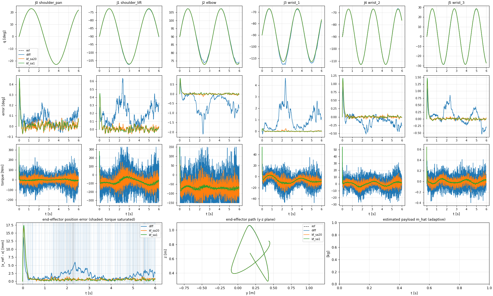

# 9. カルマンフィルタ — ノイズのあるセンサから状態を推定する

> **準備**: [起動・操作マニュアル](START_HERE.md) の 3〜4 章の手順で、**端末 1** でシミュレーションを起動し（`ros2 launch ur10e_control_lab lab.launch.py`）、
> **端末 2** で `cd ~/sandbox_for_claude/ur10e_control_lab_ws && source install/setup.bash` を済ませておきます。
> 特に断りがなければ、この章のコマンドは端末 2 で実行します。`offline_sim` と `plot_log` は Gazebo を起動していなくても実行できます。
> 終わったら端末 1 で `Ctrl+C`。動きがおかしくなったら `ros2 param set /control_lab reference hold` → `ros2 param set /control_lab controller pd_gravity` で初期姿勢の保持に戻せます。

## 9.1 この章で学ぶこと

- 実際のセンサにはノイズがあり、速度は直接測れないことが多い
- 差分による速度推定の問題（ノイズの増幅と遅れのトレードオフ）
- カルマンフィルタの「予測」と「更新」
- プロセスノイズ Q と観測ノイズ R の意味 = **モデルとセンサのどちらを信じるか**

## 9.2 理論

### 問題

関節のエンコーダは角度 q しか測れず、測定値にはノイズが乗ります。ところが、これまでのどの制御則も角速度 q̇ を使っていました（D 項、s = ė + Λe など）。

**差分 + ローパスフィルタ**:

```
q̇ ≈ (q_k − q_{k−1}) / Δt     → ノイズ 0.002 rad / 0.002 s = 1 rad/s 級の雑音！
```

ローパスフィルタでノイズを抑えると、その分だけ推定が遅れます（位相遅れ）。遅れた速度でフィードバックすると、制御が不安定になりやすくなります。

### カルマンフィルタ

各関節について、状態 x = [q, q̇]、モデルから計算した加速度 a = M⁻¹(τ − Cq̇ − g) を入力とする離散時間モデルを使います:

```
x_{k+1} = F x_k + G a_k + w      F = [[1, Δt],[0, 1]],  G = [Δt²/2, Δt]ᵀ,  w ~ N(0, Q)   （プロセスノイズ）
y_k     = H x_k + v              H = [1, 0],                            v ~ N(0, R)   （観測ノイズ）
```

**予測**（モデルで 1 ステップ進める）:
```
x⁻ = F x + G a
P⁻ = F P Fᵀ + Q
```
**更新**（測定で補正する）:
```
K = P⁻ Hᵀ (H P⁻ Hᵀ + R)⁻¹       ← カルマンゲイン
x = x⁻ + K (y − H x⁻)
P = (I − K H) P⁻
```

- Q（`process_noise_accel` σa）: モデルの加速度がどれだけ不確かか。大きい → センサを信じる（速いが雑音が多い）
- R（`measurement_noise_position` σq）: センサがどれだけ不確かか。大きい → モデルを信じる（滑らかだがモデル誤差に弱い）

カルマンフィルタは、ノイズがガウス分布でモデルが正しければ、**推定誤差の分散を最小にする**推定器です。

## 9.3 コードを読む

[estimators/kalman.py](../src/ur10e_control_lab/ur10e_control_lab/estimators/kalman.py)

- `Ideal`: シミュレータの真値をそのまま使う（`estimator: none`）
- `Diff`: 差分 + 一次ローパス（`estimator: diff`）
- `KalmanFilter`: 6 関節分の 2×2 カルマンフィルタをまとめて計算（`estimator: kf`）

```python
# 予測: モデルで加速度を計算（直前に実際に出したトルク tau_prev を使う）
a = self.model.forward_dynamics(q, qd, tau_prev)
self.x = F @ self.x + np.outer(Gv, a)
self.P = F @ self.P @ F.T + Q
# 更新: 観測は位置のみ
S = self.P[:, 0, 0] + self.sigma_q**2
K = self.P[:, :, 0] / S[:, None]
self.x = self.x + (K * innov[:, None]).T
```

センサノイズは [control_loop.py](../src/ur10e_control_lab/ur10e_control_lab/control_loop.py) の `ControlLoop.step()` で加えています。

> 注意: `estimator: none` は「ノイズの乗った位置」と「ノイズのない真の速度」を使います（速度センサが理想的な場合）。
> 実機で速度を直接測れることは少ないので、`diff` か `kf` が現実的な比較対象です。

## 9.4 実験

### 実験 9-1: ノイズを加えて推定器を比べる

```bash
ros2 param set /control_lab controller computed_torque
ros2 param set /control_lab reference sine
ros2 param set /control_lab position_noise_std 0.002     # ≈ 0.1°
ros2 param set /control_lab estimator diff                # トルクが荒れる（Gazebo でアームが細かく震える）
ros2 param set /control_lab estimator kf                  # 滑らかに
ros2 run rqt_plot rqt_plot /control_lab/command/effort[1] /control_lab/estimate/velocity[1]
```

```bash
ros2 run ur10e_control_lab offline_sim -c computed_torque -r sine -e diff --set sensor.position_noise_std=0.002
ros2 run ur10e_control_lab offline_sim -c computed_torque -r sine -e kf   --set sensor.position_noise_std=0.002
```



参考結果（計算トルク法、ノイズ 0.002 rad）:

| 推定器 | 手先誤差 RMS | トルクの荒さ（shoulder_lift の \|Δτ\| 平均 [Nm]） | 飽和率 |
|---|---|---|---|
| diff（差分 + 20 Hz LPF） | 2.5 mm | 125 Nm | 13.6 % |
| kf（σa = 20、既定） | 2.1 mm | 32 Nm | 0.7 % |
| kf（σa = 1） | 2.2 mm | **2.5 Nm** | 0.1 % |

Gazebo でも同様の結果です（diff: 飽和 14 %、kf: 0.8 %）。

### 実験 9-2: モデルを信じるか、センサを信じるか

PD＋重力補償、ノイズ 0.002 rad で、σa とモデルの正しさを変えます:

```bash
ros2 run ur10e_control_lab offline_sim -c pd_gravity -r sine -e kf --set sensor.position_noise_std=0.002 \
    --set estimator.kf.process_noise_accel=1                                  # 正しいモデルを強く信じる
ros2 run ur10e_control_lab offline_sim -c pd_gravity -r sine -e kf --set sensor.position_noise_std=0.002 \
    --set estimator.kf.process_noise_accel=1 --set model_payload_mass=0.0     # 間違ったモデルを強く信じる
ros2 run ur10e_control_lab offline_sim -c pd_gravity -r sine -e kf --set sensor.position_noise_std=0.002 \
    --set estimator.kf.process_noise_accel=1 --set estimator.kf.use_model_acceleration=false   # 等速モデル
```

| モデル | σa | KF の予測モデル | 手先誤差 RMS | トルクの荒さ（shoulder_pan の \|Δτ\| 平均 [Nm]） |
|---|---|---|---|---|
| 正しい | 1 | 動力学モデル | 10.4 mm | **0.8** |
| 正しい | 20 | 動力学モデル | 10.4 mm | 8.4 |
| 正しい | 1 | 等速モデル（a = 0） | **発散** | — |
| 負荷を知らない | 1 | 動力学モデル | **92 mm** | 0.8 |
| 負荷を知らない | 20 | 動力学モデル | 51 mm | 8.4 |
| 負荷を知らない | 20 | 等速モデル | 35 mm | 8.5 |

読み取れること:
- **正しいモデル × 小さい σa** が最良（ノイズがほぼ消える）
- **間違ったモデル × 小さい σa** は最悪（推定値がモデルに引きずられる）
- **等速モデル × 小さい σa** は「加速しない」と強く信じるので推定が遅れ、制御が発散する
- 迷ったら σa を大きめに（センサ寄りに）しておくのが安全

## 9.5 考察課題

1. 定常状態のカルマンゲイン K は、σa/σq の比だけで決まります。σa = 20, σq = 0.001 のときの K を計算してみましょう（ヒント: `scipy.linalg.solve_discrete_are`）。
2. カルマンフィルタは「最適な推定器」なのに、実験 9-2 では設定によって結果が大きく悪化しました。「最適」の前提は何だったでしょうか？
3. 適応制御（6 章）で推定した m̂ を KF のモデルに反映すれば、モデル誤差の問題は解決するでしょうか？ どんな危険がありますか？
4. 拡張カルマンフィルタ（EKF）は、どのような場面で必要になりますか？（例: 手先の位置をカメラで測る場合、移動ロボットの自己位置推定）

→ 次は [10. 演習: 自分の制御則を作る](10_your_controller.md)
